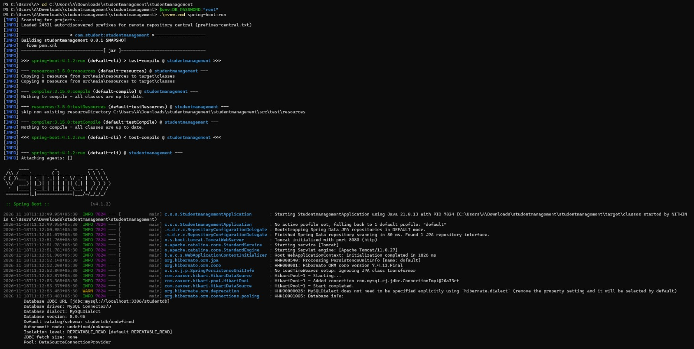
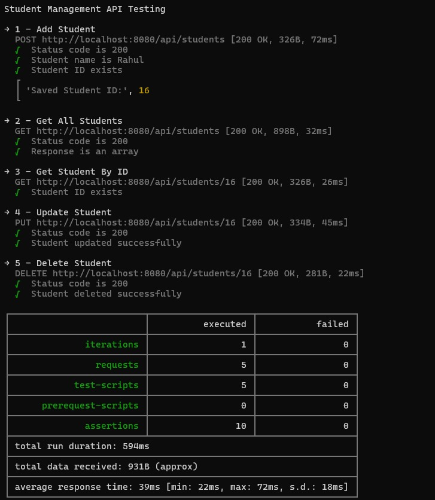
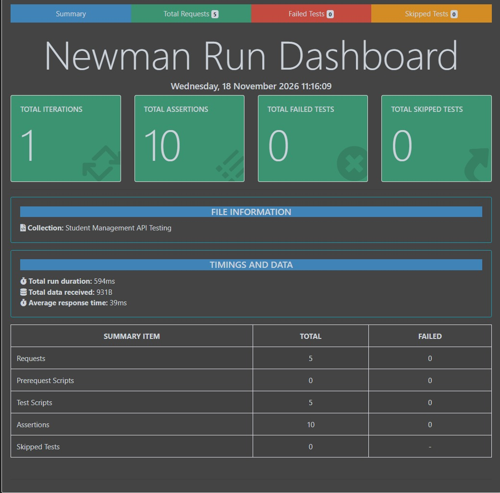

# Student Management System

A REST API built with Java Spring Boot and MySQL to create, read, update and delete student records. All endpoints are tested with Postman and automated with Newman.

## Technologies Used

- Java 21
- Spring Boot 4.1.2 (Web MVC, embedded Tomcat)
- Spring Data JPA (Hibernate)
- MySQL 8
- Maven
- Postman
- Newman

## Architecture

The project uses a layered architecture:

```
Client (Postman / Newman)
        │  HTTP + JSON
        â–¼
StudentController   →  handles HTTP requests on /api/students
        │
        â–¼
StudentService      →  business logic (e.g. find before update)
        │
        â–¼
StudentRepository   →  Spring Data JPA, no SQL written by hand
        │  JPA / Hibernate
        â–¼
MySQL (studentdb)
```

## Project Structure

```
src/main/java/com/student/studentmanagement/
├── StudentmanagementApplication.java   # entry point
├── controller/StudentController.java   # REST endpoints
├── service/StudentService.java         # business logic
├── repository/StudentRepository.java   # database access
└── model/Student.java                  # entity: id, name, email, course
src/main/resources/application.properties
```

## Prerequisites

- Java 21
- MySQL running on `localhost:3306`
- Node.js (only for running Newman)

## Setup

1. **Create the database** (Hibernate creates the table, but not the database):

   ```sql
   CREATE DATABASE studentdb;
   ```

2. **Set the database credentials** as environment variables. `DB_USERNAME` defaults to `root` if not set; `DB_PASSWORD` is required.

   Windows (PowerShell):
   ```powershell
   $env:DB_USERNAME="root"
   $env:DB_PASSWORD="your_password"
   ```

   Linux / macOS:
   ```bash
   export DB_USERNAME=root
   export DB_PASSWORD=your_password
   ```

## Run the Application

Windows (PowerShell):
```powershell
.\mvnw.cmd spring-boot:run
```

Linux / macOS:
```bash
./mvnw spring-boot:run
```

When the app starts, Tomcat runs on port 8080 and connects to `studentdb` through HikariCP. The API runs at: http://localhost:8080



## API Endpoints

| Method | Endpoint | Description |
|---|---|---|
| POST | /api/students | Add a student |
| GET | /api/students | Get all students |
| GET | /api/students/{id} | Get a student by ID |
| PUT | /api/students/{id} | Update a student |
| DELETE | /api/students/{id} | Delete a student |

### Example: Add a student

Request:
```http
POST /api/students
Content-Type: application/json

{
  "name": "Rahul",
  "email": "rahul@gmail.com",
  "course": "Information Science"
}
```

Response (`200 OK`):
```json
{
  "id": 16,
  "name": "Rahul",
  "email": "rahul@gmail.com",
  "course": "Information Science"
}
```

`DELETE` returns the text `Student deleted successfully`.

## API Testing

### Postman

Import `Student_API_Collection.json` into Postman and run the requests **in order**. "Add Student" saves the new student's ID in the `studentId` collection variable, which the later requests use.

| # | Request | Checks |
|---|---|---|
| 1 | Add Student | Status 200, name is Rahul, ID exists |
| 2 | Get All Students | Status 200, response is an array |
| 3 | Get Student By ID | Returned ID matches |
| 4 | Update Student | Status 200, name and course updated |
| 5 | Delete Student | Status 200, confirmation message |

### Newman (automated)

Install Newman and the HTML reporter:
```bash
npm install -g newman newman-reporter-htmlextra
```

Run the tests:
```bash
newman run Student_API_Collection.json
```

Run the tests and generate the HTML report:
```bash
newman run Student_API_Collection.json -r cli,htmlextra --reporter-htmlextra-export Student_API_Report.html
```

## Test Results

| Iterations | Requests | Assertions | Failed | Avg. response time | Total run time |
|---|---|---|---|---|---|
| 1 | 5 | 10 | 0 | 39 ms (min 22 ms, max 72 ms) | 594 ms |

All 10 assertions passed.

### Newman run in the terminal



### Newman HTML report



See `Student_API_Report.html` for the full report.

## Future Enhancements

- Return `404 Not Found` for unknown IDs (currently a server error)
- Validate input with `@Valid`, `@NotBlank` and `@Email`
- Return proper status codes with `ResponseEntity` (e.g. `201 Created`)
- Pagination and search
- Authentication with Spring Security

## Authors

- Nithin HP (20241ISE0033)
- Hruthik Gowda A (20241ISE0036)

